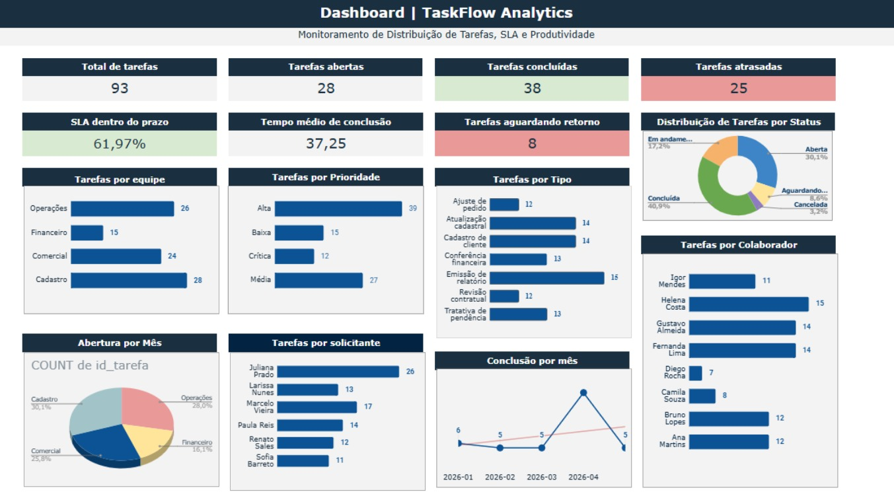

# TaskFlow Analytics — gestão de tarefas, SLA e produtividade

Projeto de portfólio que apresenta um fluxo de análise operacional para acompanhar tarefas, prazos e produtividade, conectando Google Sheets, arquivos CSV, SQL no Supabase e uma planilha com dashboard gerencial.

**Acesso rápido:** [planilha do projeto](<spreadsheets/TaskFlowAnalytics _Gestão de Tarefas, SLA e Produtividade.xlsx>) · [relatório executivo em PDF](<pdf/Projeto de Banco de Dados e Análise Operacional - TaskFlow Analytics.pdf>) · [documentação do fluxo](docs/arquitetura_e_fluxo.md) · [scripts SQL](sql/) · [imagens do projeto](images/)

## Em 30 segundos

O projeto parte de um cenário fictício de gestão de tarefas em que é importante acompanhar volume, status, cumprimento de SLA e tempo de conclusão. Os registros são organizados no Google Sheets, transferidos por CSV para tabelas relacionais no Supabase e consultados com SQL. A planilha apresenta os indicadores em tabelas e gráficos para facilitar a leitura operacional.

## O que é analisado

O dashboard reúne indicadores e recortes por status, equipe, colaborador, prioridade, tipo de tarefa e solicitante. Também contempla o percentual de tarefas dentro do SLA, o tempo médio de conclusão e a evolução de aberturas e conclusões por período.

A proposta é demonstrar como estruturar uma rotina operacional para análise. Os números mostrados nos artefatos pertencem ao cenário do projeto; não representam uma operação real.

## Como os componentes se conectam

1. **Google Sheets:** registro operacional das tarefas.
2. **CSV:** etapa de transferência entre a planilha e o banco; o fluxo atual não é uma sincronização automática.
3. **Supabase e SQL:** armazenamento relacional, tabela de entrada e consolidação dos registros para consulta.
4. **Planilha e dashboard:** apresentação dos indicadores e dos recortes operacionais.

O fluxo e a finalidade de cada script estão descritos em [Arquitetura e fluxo de dados](docs/arquitetura_e_fluxo.md).

## Como explorar

- Comece pela [visão geral do repositório](docs/README.md) para localizar cada material.
- Abra a [planilha Excel](<spreadsheets/TaskFlowAnalytics _Gestão de Tarefas, SLA e Produtividade.xlsx>) para explorar a apresentação dos indicadores. Ela também pode ser importada em um aplicativo compatível com arquivos .xlsx.
- Consulte os [scripts SQL](sql/) para acompanhar a criação das tabelas, a etapa de entrada, a carga e a consulta de detalhamento. Antes de executar em qualquer ambiente, leia o aviso sobre o script de carga na [documentação do fluxo](docs/arquitetura_e_fluxo.md).
- Veja a [imagem da estrutura no Supabase](images/Estrutura-supabase.jpeg) e a [visão da planilha](images/README-planilha.jpeg).
- O [relatório executivo em PDF](<pdf/Projeto de Banco de Dados e Análise Operacional - TaskFlow Analytics.pdf>) reúne a apresentação complementar do projeto.

## Competências demonstradas

A própria entrega permite observar organização de dados operacionais, modelagem relacional, criação e consulta de tabelas com SQL, integração por CSV, definição de indicadores de SLA e produtividade e comunicação visual em planilha.

## Escopo e limitações

Este é um projeto de portfólio baseado em um cenário fictício. A integração entre Google Sheets e Supabase ocorre por arquivos CSV, sem sincronização automática documentada. Os indicadores são descritivos e dependem das definições de status, prazo e SLA adotadas no cenário; não devem ser interpretados como evidência sobre uma operação real.

## Estrutura principal

- images/ — prévia do dashboard, da estrutura do banco e da planilha.
- spreadsheets/ — planilha de análise e dashboard.
- sql/ — scripts de criação, carga e consulta.
- pdf/ — relatório executivo complementar.
- docs/ — índice e documentação da arquitetura e do fluxo.

---
Projeto desenvolvido por Karol Antunes Silva como material de portfólio em análise de dados.
